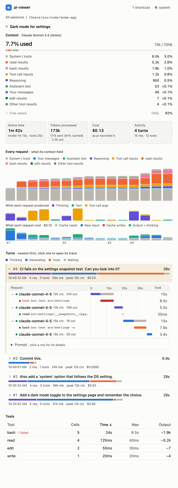

# pi-viewer

A live dashboard of your [pi](https://github.com/earendil-works/pi) coding agent sessions, in the browser.

<picture>
  <source media="(prefers-color-scheme: dark)" srcset="docs/screenshot-dark.png">
  
</picture>

- **Sessions**: every pi session on disk, by day or by project, with the running ones on top.
- **Context**: what fills the model's window: system prompt and tools, your messages, reasoning, tool results.
- **Overview**: active time, tokens processed (and how much was cached), cost, and turns, requests and tool calls.
- **Every request**: what each request's context held, what it produced, and what it cost.
- **Turns**: a trace waterfall per prompt, with its requests and tool calls.
- **Tools**: calls, time and output per tool.

It updates live, and works for sessions you ran earlier too: it reads the files pi writes under `~/.pi/agent/sessions`.

## Quickstart

Requires pi.

```sh
pi install git:github.com/koaning/pi-viewer@release
```

Start pi with `pi --viewer` to open the session list, or type `/viewer` in a session to open that one.

To run the dashboard without pi, run `node dist/cli.js` in a build (see `--help` for options). Press <kbd>?</kbd> for keyboard shortcuts.

Models without a price (e.g. Ollama) can be costed as another model via **Price unpriced models…** in a session's header.

## Develop

```sh
make dev            # API on :4546 and Vite with HMR on :5173, opened in the browser
bun run typecheck
bun test
bun run build
bun run screenshot  # regenerate docs/screenshot-*.png from a made-up session (after a build)
make release        # check, build and force-push the installable package to the release branch
```
