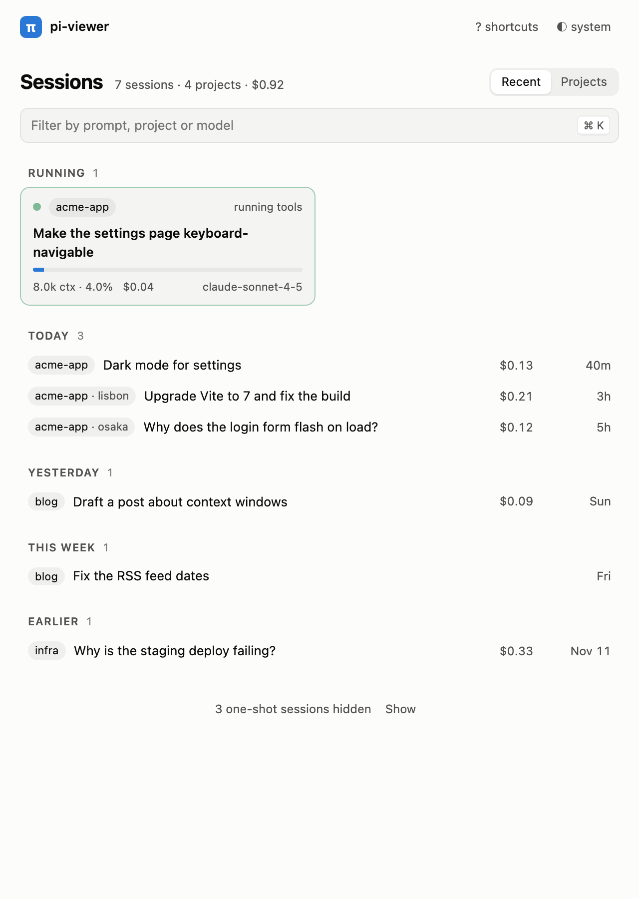

# pi-viewer

A live dashboard of your [pi](https://github.com/earendil-works/pi) coding agent sessions, in the browser.

<picture>
  <source media="(prefers-color-scheme: dark)" srcset="docs/screenshot-dark.png">
  
</picture>

<picture>
  <source media="(prefers-color-scheme: dark)" srcset="docs/home-dark.png">
  
</picture>

- **Sessions**: every pi session on disk, by day or by project (Conductor worktrees fold into their repository). The ones running now come first as cards, each with its context use and cost, so you can keep an eye on several at once. Sessions of one prompt and one reply, such as title generators, are hidden until you ask for them.
- **Context**: what fills the model's window: system prompt and tools, your messages, reasoning, tool results, and free space.
- **Overview**: active time, tokens processed (and how much was cached), cost, and turns, requests and tool calls.
- **Every request**: what each request's context held, what it produced, and what it cost.
- **Turns**: a trace waterfall per prompt, with its requests and tool calls.
- **Tools**: calls, time and output per tool.

It's a port of [opencode-viewer](https://github.com/koaning/opencode-viewer) to pi. It needs no pi extension: it reads the session files pi writes under `~/.pi/agent/sessions` and follows them as they grow, so it also works for sessions you ran earlier.

## Quickstart

Requires Node 20+ (or Bun) and pi.

```sh
git clone https://github.com/koaning/pi-viewer && cd pi-viewer
bun install && bun run build
node dist/cli.js            # opens http://localhost:4545
```

Press `⌘K` (or `/`) to search, `↑`/`↓` or `j`/`k` to move through the list, `Enter` to open a session and `Esc` to go back. `?` lists every shortcut.

Each session has its own URL (`#/s/<id>`), so you can follow several live sessions in separate tabs. To open one directly, pass its id (or the start of it) or its `.jsonl` file: `node dist/cli.js 01a2079b`.

```
-p, --port <n>     Port to serve on (default 4545; the next free one if taken)
    --host <name>  Interface to listen on (default 127.0.0.1)
    --dir <path>   pi's sessions directory (default $PI_CODING_AGENT_SESSION_DIR,
                   else $PI_CODING_AGENT_DIR/sessions, else ~/.pi/agent/sessions)
    --no-open      Don't open the browser
```

Sessions on another machine: run pi-viewer there with `--no-open` and forward the port with `ssh -L 4545:localhost:4545 host`.

Models without a price (e.g. Ollama) can be costed as another model via **Price unpriced models…** in a session's header.

## How it reads pi's sessions

- **Cost** is what pi recorded for each request. A request recorded at $0 (subscriptions, local models) is estimated from pi's model catalog, or from the stand-in model you pick, and shown with ≈.
- **Context window and prices** come from the pi you have installed (its pi-ai model list), plus `models-store.json` and your `models.json`.
- **The active branch**: a session is a tree. The dashboard follows the branch the last write extends, and says how many other branches there are.
- **Live state**: pi writes a request once the model's reply is done. While a session waits on its model or tools (and has written in the last 10 minutes), it counts as running, and a pending request ticks in its trace.
- **Thinking time** is an estimate: pi doesn't time thinking, so a request's thinking gets its reasoning share of the output, out of the model's time.
- **Context makeup** is estimated from characters (÷ 4), anchored on the first request after the start or after a compaction: that request's context minus what's in the transcript is the system prompt and tools.

The server only answers to `localhost` (transcripts hold your code and maybe secrets). Use `--host` only on a network you trust.

## Develop

```sh
bun run dev         # API on :4546 and Vite with HMR on :5173
bun run typecheck
bun test
bun run build
bun run screenshot  # regenerate docs/screenshot-*.png from a made-up session (after a build)
```

The pieces:

- `src/pi/`: pi's file format. `branch.ts` picks the active branch; `normalize.ts` folds tool results into their requests.
- `src/model.ts`: turns, timings, the context estimate and tool stats, from opencode-viewer.
- `src/server/`: follows the files (`tail.ts`, `sessions.ts`, `watch.ts`), reads the model catalog, and serves the API with server-sent events.
- `src/client/`: the Solid app. `view/` is opencode-viewer's dashboard.
